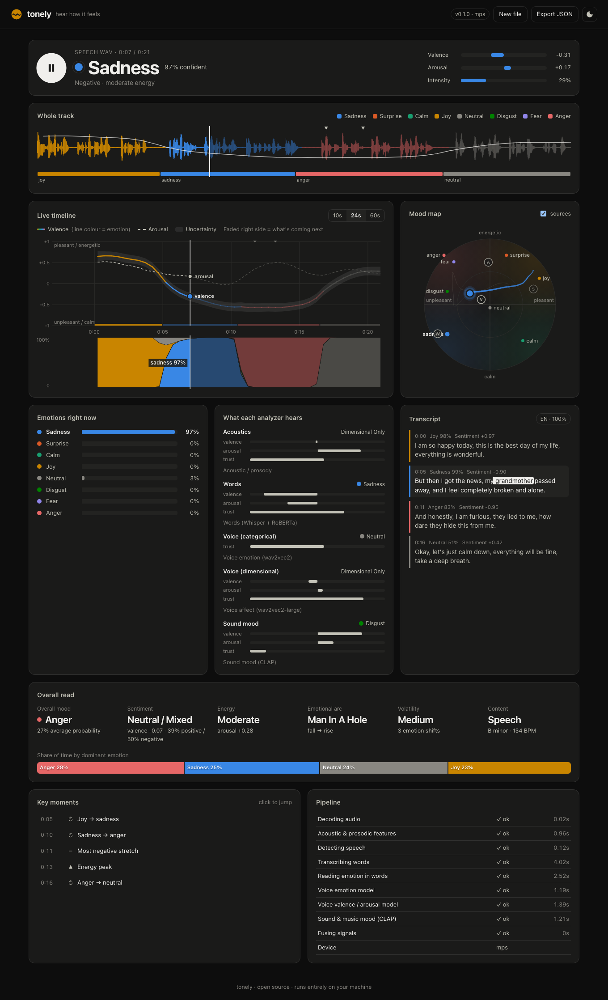

# tonely

**Hear how it feels.** tonely is an open-source audio sentiment and emotion analyzer. Drop in any audio file. It listens with five independent analyzers, maps out the whole emotional timeline in advance, and then plays the file back while the graphs move with it: a scrolling valence/arousal chart, an emotion stream, a mood map with a moving dot, live per-analyzer meters, and a karaoke-style transcript.

Everything runs locally on your machine. No API keys, and nothing leaves your computer.



## What it does

- **Upload → auto-analysis.** tonely decodes almost any format (mp3, wav, m4a, flac, ogg, opus, webm, mp4) with no system ffmpeg needed, then runs the full pipeline with a live progress view.
- **Pre-plotted timeline.** Before you press play, the whole-track overview already shows the waveform coloured by emotion, the valence curve, the emotion segments and the key moments.
- **Live playback.** Press start and the live chart scrolls around the playhead. The part still to come is faded, so you can see what's next. The mood-map dot glides through valence/arousal space with a fading trail and an uncertainty ellipse, and the emotion bars and per-analyzer meters update in real time.
- **Transcript.** Each spoken segment is coloured by its emotion and sentiment, and the current word is highlighted. Click any word to jump to it. Non-English speech is translated so its emotion can still be read.
- **Overall read.** Shows dominant mood, sentiment, energy, volatility and content type (speech, music, speech over music). It also gives key and tempo, the share of time spent in each emotion, and the emotional *story arc*.
- **Key moments.** Lists energy peaks, the most positive and most negative stretches, and every emotion shift. Click one to jump to it.
- **Export.** Download the full analysis as JSON.

## How it works

tonely deliberately does not trust any single model. Each analyzer produces a timeline of valence, arousal and/or an emotion distribution, together with a **confidence** for every moment. A probabilistic fusion stage then combines them.

```
              ┌──────────────────────────────────────────────────────────────┐
 audio ──►    │ Acoustics      loudness · brightness · flux · pitch · tempo  │──┐
 (PyAV)       │                key & mode (Krumhansl) · consonance           │  │
              ├──────────────────────────────────────────────────────────────┤  │
              │ Voice (cat.)   wav2vec2 SER — neutral/happy/angry/sad        │──┤
              │ Voice (dim.)   wav2vec2-large — arousal/dominance/valence    │──┤   Kalman + RTS smoother (V/A/D)
              ├──────────────────────────────────────────────────────────────┤  ├─► log-opinion pool (8 emotions)
              │ Words          Whisper ASR (+translate) → RoBERTa emotion    │──┤   sticky HMM forward–backward
              │                + RoBERTa sentiment, with context window      │  │   Viterbi segments · moments · arc
              ├──────────────────────────────────────────────────────────────┤  │
              │ Sound mood     CLAP zero-shot vs. prompt ensembles           │──┘
              │                (emotions, circumplex poles, content type)    │
              └──────────────────────────────────────────────────────────────┘
               Silero VAD decides where speech is → weights the speech models
```

### The analyzers

| Channel | Model / method | What it's good at |
|---|---|---|
| **Acoustics** | Hand-built prosodic & musical descriptors (librosa): loudness, spectral centroid/flux/flatness, high-frequency energy, YIN pitch level & variability, onset rate, local tempo, harmonic/percussive balance, key and mode via Krumhansl–Kessler profiles. Robust within-file z-scores are blended with absolute anchors. | Arousal for *any* audio. Always available. |
| **Voice (categorical)** | [`superb/wav2vec2-base-superb-er`](https://huggingface.co/superb/wav2vec2-base-superb-er), IEMOCAP 4-class SER. Coarse labels are spread over the finer emotions they cover. | Tone of voice |
| **Voice (dimensional)** | [`audeering/wav2vec2-large-robust-12-ft-emotion-msp-dim`](https://huggingface.co/audeering/wav2vec2-large-robust-12-ft-emotion-msp-dim) (Wagner et al., 2023), trained on MSP-Podcast | Continuous valence/arousal from the voice, one of the best open models for valence from speech |
| **Words** | [faster-whisper](https://github.com/SYSTRAN/faster-whisper) with word timestamps, then [`j-hartmann/emotion-english-distilroberta-base`](https://huggingface.co/j-hartmann/emotion-english-distilroberta-base) (7 emotions) and [`cardiffnlp/twitter-roberta-base-sentiment-latest`](https://huggingface.co/cardiffnlp/twitter-roberta-base-sentiment-latest). Each utterance is scored alone and together with its predecessor. Non-English speech is translated by Whisper first. | Semantic emotion, meaning what's actually being said |
| **Sound mood** | [`laion/clap-htsat-unfused`](https://huggingface.co/laion/clap-htsat-unfused) zero-shot, comparing audio embeddings against ensembles of mood descriptions, circumplex poles and content-type prompts | Music and non-speech audio |

### The fusion

1. **Dimensional (valence, arousal, dominance).** Each analyzer is treated as a noisy sensor in a 1-D linear-Gaussian state-space model with a mean-reverting random-walk prior. Its observation variance scales with `1 / confidence`. A **Kalman filter with a Rauch–Tung–Striebel backward pass** gives the smoothed posterior mean *and* its standard deviation, which is the uncertainty band you see in the UI. Missing observations (for example, words during an instrumental break) are bridged by the prior.
2. **Categorical (8 emotions).** At every step tonely computes a **logarithmic opinion pool**, a confidence-weighted product of experts over all categorical analyzers. Two more experts join it: a circumplex-kernel likelihood from the fused valence/arousal, and a silence prior. "Neutral" outputs count partly as abstention, so a classifier that falls back to neutral when unsure can't veto a confident signal from elsewhere.
3. **Temporal coherence.** The pooled frame posteriors act as emissions of a **sticky HMM**. Its transitions favour neighbouring emotions on the circumplex. **Forward–backward** gives the smoothed per-moment probabilities, and **Viterbi** gives clean emotion segments.
4. **Narrative.** Peaks and dips (prominence-based), emotion shifts, volatility, and a match of the valence trajectory against the six **emotional story arcs** from Reagan et al. (2016): rags-to-riches, tragedy, man-in-a-hole, Icarus, Cinderella and Oedipus.

The shared emotion space has eight emotions: **joy, calm, sadness, anger, fear, surprise, disgust, neutral**. Each one also has a prototype position on Russell's valence–arousal circumplex.

## Install

Requires Python 3.10+.

```bash
git clone https://github.com/5ivatej/tonely.git
cd tonely
python -m venv .venv && source .venv/bin/activate
pip install -e ".[ml]"
```

The first analysis downloads the models from Hugging Face (about 3 GB in total) and caches them. Use the `lite` profile for a much smaller download.

The models run on Apple-silicon GPUs (MPS), NVIDIA GPUs (CUDA) or the CPU, and tonely picks the device automatically.

## Use

```bash
tonely serve                 # opens http://127.0.0.1:8765
tonely serve --profile lite  # smaller/faster: no CLAP, no large voice model, Whisper base
```

Drop a file, wait for the analysis, then press start. **Space** plays and pauses, and **← / →** seek 5 seconds. Click anywhere on the overview, the live chart, a transcript word or a key moment to jump there.

Command line / scripting:

```bash
tonely analyze talk.mp3 -o talk.json            # full JSON result
tonely analyze song.flac --profile acoustic     # model-free, very fast
tonely analyze call.m4a --whisper medium --device cpu
```

```python
from tonely.pipeline import analyze
from tonely.config import Config

r = analyze("clip.wav", Config.profile("full"))
print(r["fused"]["summary"])
```

### Profiles

| Profile | Analyzers | Download |
|---|---|---|
| `full` *(default)* | acoustics, VAD, Whisper small, text emotion + sentiment, voice categorical, voice dimensional, CLAP | ~3 GB |
| `lite` | acoustics, VAD, Whisper base, text emotion + sentiment, voice categorical | ~1 GB |
| `acoustic` | acoustics only | none |

If a model can't be loaded, tonely skips that analyzer, says so in the **Pipeline** panel, and fuses whatever is left.

### Output (abridged)

```jsonc
{
  "file": { "name": "clip.wav", "duration": 21.7 },
  "emotions": ["sadness", "surprise", "calm", "joy", "neutral", "disgust", "fear", "anger"],
  "grid": { "hop": 0.5, "win": 3.0, "times": [0.25, 0.75, ...] },
  "fused": {
    "valence": [...], "arousal": [...], "dominance": [...],
    "valence_sd": [...], "arousal_sd": [...],
    "probs": [[...8 per step...]],
    "segments": [{ "start": 0, "end": 5, "emotion": "joy", "confidence": 0.99 }],
    "moments": [{ "t": 11.2, "kind": "low", "title": "Most negative stretch" }],
    "summary": { "dominant_emotion": "...", "sentiment": "...", "arc": { "shape": "Man in a hole (fall → rise)" }, ... },
    "sources": [{ "name": "ser_dim", "valence": [...], "arousal": [...], "weight": [...] }, ...]
  },
  "transcript": { "language": "en", "segments": [{ "text": "...", "emotion": "joy", "sentiment": 0.97, "words": [...] }] },
  "content": { "kind": "speech", "speech_intervals": [[0.0, 4.3], ...] },
  "acoustic": { "summary": { "tempo_bpm": 134, "key": "B minor" }, ... },
  "analyzers": [{ "stage": "asr", "status": "ok", "seconds": 4.0 }, ...]
}
```

## Development

```bash
pip install -e ".[ml,dev]"
pytest
```

```
tonely/
  audio.py        decoding (PyAV) + waveform peaks
  acoustic.py     model-free prosodic / musical affect
  speech.py       VAD + categorical & dimensional speech emotion
  transcript.py   Whisper ASR + text emotion & sentiment
  music.py        CLAP zero-shot mood & content type
  fusion.py       Kalman/RTS, opinion pooling, HMM, arcs, moments
  pipeline.py     orchestration, progress, caching
  server.py       FastAPI app (upload → job → poll → result)
  web/            the UI: vanilla JS + canvas, no build step
```

Results are cached in `~/.cache/tonely` (override with `TONELY_CACHE`), keyed on file content and config, so reopening the same file is instant.

## Limitations

- Emotion recognition is probabilistic and culturally loaded. Treat the output as a lens, not as ground truth.
- The text models are English. Other languages go through Whisper's translation, which loses some nuance.
- The categorical voice model was trained on acted English speech (IEMOCAP). Valence from the voice alone is hard, which is why the dimensional model and the words carry more weight for it.
- CLAP's mood reading is zero-shot. It works best on music and broad sound textures.
- Analyzing speech with every model takes roughly 0.3–1× real time on a laptop.

## Model licenses

tonely's code is MIT-licensed. The models are downloaded at runtime and keep their own licenses. Note that `audeering/wav2vec2-large-robust-12-ft-emotion-msp-dim` is **CC BY-NC-SA 4.0 (non-commercial)**. For commercial use, run with `--profile lite` or disable it with `Config(use_ser_dim=False)`.

## References

- Russell, J. A. (1980). *A circumplex model of affect.*
- Juslin, P. N. & Laukka, P. (2003). *Communication of emotions in vocal expression and music performance.*
- Eyben, F. et al. (2016). *The Geneva Minimalistic Acoustic Parameter Set (GeMAPS).*
- Wagner, J. et al. (2023). *Dawn of the transformer era in speech emotion recognition: closing the valence gap.*
- Elizalde, B. et al. / Wu, Y. et al. (2023). *CLAP: Learning audio concepts from natural language supervision.*
- Reagan, A. J. et al. (2016). *The emotional arcs of stories are dominated by six basic shapes.*
- Krumhansl, C. L. (1990). *Cognitive Foundations of Musical Pitch.*

Inspired by the clean, do-one-thing-well spirit of [tinytag](https://github.com/tinytag/tinytag).

## License

MIT
